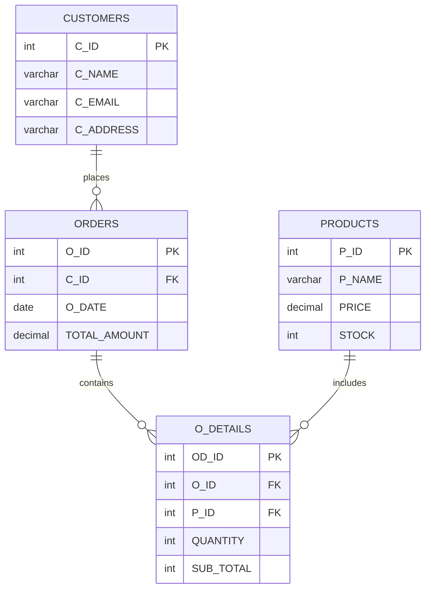

# 🔍 PR-1: Data Digger – SQL Database Management Project

<p align="center">

  
  
  

</p>

## 📌 About The Project

**Data Digger** is my first SQL practice project, developed to strengthen my understanding of MySQL and relational database management.

The project focuses on creating and managing a store database containing customer information, orders, product details, and order transactions.

Through this project, I practiced SQL queries and learned how to retrieve, insert, update, delete, filter, sort, and analyze data.

## 🎯 Project Objectives

- Understand database creation and table structures.
- Practice SQL CRUD operations.
- Work with primary keys and auto-increment.
- Retrieve data using different conditions.
- Perform aggregate calculations.
- Practice subqueries.
- Analyze orders, customers, and product information.

---

## 🗄️ Database Structure

**Database Name:** `STORE`

The database contains four main tables:

| Table | Description |
|---|---|
| 👤 CUSTOMERS | Stores customer information |
| 🛒 ORDERS | Stores customer order information |
| 📦 PRODUCTS | Stores product details and stock |
| 🧾 O_DETAILS | Stores individual order product details |

### 📊 Database Relationship Diagram



*Note: This diagram represents the intended relationships. Foreign key constraints have not yet been implemented in the actual SQL tables.*

---

## 📂 Table Overview

### 1. 👤 CUSTOMERS

Stores customer details.

| Column | Data Type | Description |
|---|---|---|
| C_ID | INT | Customer ID (Primary Key) |
| C_NAME | VARCHAR(50) | Customer Name |
| C_EMAIL | VARCHAR(50) | Customer Email (Unique) |
| C_ADDRESS | VARCHAR(200) | Customer Address |

**Operations performed:**
- Created the CUSTOMERS table.
- Inserted 9 customer records.
- Updated customer address.
- Deleted a customer record.
- Retrieved a specific customer using `LIKE`.

### 2. 🛒 ORDERS

Stores customer order information.

| Column | Data Type | Description |
|---|---|---|
| O_ID | INT | Order ID |
| C_ID | INT | Customer ID |
| O_DATE | DATE | Order Date |
| TOTAL_AMOUNT | DECIMAL(10,2) | Total Order Amount |

**Operations performed:**
- Created the ORDERS table.
- Inserted 10 order records.
- Retrieved orders using `WHERE`.
- Updated order amounts.
- Deleted an order.
- Filtered recent orders using `DATEDIFF()`.
- Calculated highest, lowest, and average order amounts.

### 3. 📦 PRODUCTS

Stores product information and available stock.

| Column | Data Type | Description |
|---|---|---|
| P_ID | INT | Product ID (Primary Key) |
| P_NAME | VARCHAR(50) | Product Name |
| PRICE | DECIMAL(10,2) | Product Price |
| STOCK | INT | Available Stock |

**Operations performed:**
- Created the PRODUCTS table.
- Inserted product records.
- Sorted products by price.
- Updated product prices.
- Deleted a product.
- Filtered products using `BETWEEN`.
- Found the highest and lowest-priced products using subqueries.

### 4. 🧾 O_DETAILS (Order Details)

Stores information about products included in individual orders.

| Column | Data Type | Description |
|---|---|---|
| OD_ID | INT | Order Detail ID |
| O_ID | INT | Order ID |
| P_ID | INT | Product ID |
| QUANTITY | INT | Purchased Quantity |
| SUB_TOTAL | INT | Subtotal Amount |

**Operations performed:**
- Created the O_DETAILS table.
- Inserted 10 transaction records.
- Retrieved details using `WHERE`.
- Calculated total sales using `SUM()`.
- Retrieved the top 3 records using `ORDER BY` and `LIMIT`.
- Counted how many times a product appeared using `COUNT()` and `GROUP BY`.

---

## 🧠 SQL Concepts Practiced

| Category | SQL Commands / Functions |
|---|---|
| Database Management | `CREATE DATABASE`, `USE` |
| Table Management | `CREATE TABLE` |
| Data Insertion | `INSERT INTO` |
| Data Retrieval | `SELECT`, `WHERE` |
| Data Modification | `UPDATE` |
| Data Deletion | `DELETE` |
| Filtering | `LIKE`, `BETWEEN` |
| Sorting | `ORDER BY`, `ASC`, `DESC` |
| Limiting | `LIMIT` |
| Aggregate Functions | `SUM()`, `COUNT()`, `MAX()`, `MIN()`, `AVG()` |
| Grouping | `GROUP BY` |
| Date Functions | `NOW()`, `DATE()`, `DATEDIFF()` |
| Subqueries | Nested `SELECT` queries |
| Constraints | `PRIMARY KEY`, `UNIQUE`, `AUTO_INCREMENT`, `DEFAULT` |

---

## 💡 Some Important Queries

### 🔹 1. Find the Most Expensive Product

```sql
SELECT *
FROM PRODUCTS
WHERE PRICE = (
    SELECT MAX(PRICE)
    FROM PRODUCTS
);
```

### 🔹 2. Find the Cheapest Product

```sql
SELECT *
FROM PRODUCTS
WHERE PRICE = (
    SELECT MIN(PRICE)
    FROM PRODUCTS
);
```

### 🔹 3. Calculate Total Sales

```sql
SELECT SUM(SUB_TOTAL) AS TOTAL_SALES
FROM O_DETAILS;
```

### 🔹 4. Find Recent Orders (Last 30 Days)

```sql
SELECT *
FROM ORDERS
WHERE DATEDIFF(CURDATE(), O_DATE) < 30;
```

### 🔹 5. Count Product Sales Records

```sql
SELECT P_ID, COUNT(*) AS TOTAL_TIMES_SOLD
FROM O_DETAILS
GROUP BY P_ID;
```

### 🔹 6. Find the Top 3 Orders by Quantity

```sql
SELECT *
FROM O_DETAILS
ORDER BY QUANTITY DESC
LIMIT 3;
```

---

## 📈 Project Learning Outcomes

By completing this project, I practiced:

- Building a relational database using MySQL.
- Creating tables with different data types.
- Managing customer and product records.
- Performing CRUD operations.
- Using aggregate functions for data analysis.
- Filtering and sorting database records.
- Writing subqueries to retrieve specific information.
- Understanding how multiple tables can be connected.

---

## ⚙️ Technologies Used

- **Database:** MySQL
- **Language:** SQL
- **Environment:** MySQL Command Line Client

---

## 🚀 How to Run This Project

1. Install MySQL Server.
2. Open MySQL Command Line Client.
3. Create the database:

```sql
CREATE DATABASE STORE;
```

4. Select the database:

```sql
USE STORE;
```

5. Create the four tables.
6. Insert the sample records.
7. Execute the SQL queries to explore and analyze the data.

---

## 🔮 Future Improvements

- Implement foreign key constraints.
- Practice INNER JOIN, LEFT JOIN, RIGHT JOIN, and SELF JOIN.
- Explore advanced subqueries and correlated subqueries.
- Create views for frequently used queries.
- Implement stored procedures and triggers.
- Perform more advanced sales analysis.

---

## 👨‍💻 Author

**Krish Delvadiya**

🎓 BCA Student | AI/ML & Data Science Learner

- GitHub: [@krishdelvadiya34-design](https://github.com/krishdelvadiya34-design)
- LinkedIn: [Connect with me](https://www.linkedin.com/in/krish-delvadiya-630001413/)

---

<p align="center">

  ⭐ If you find this project interesting, feel free to explore it!

  **Learning SQL, One Query at a Time! 🚀**

</p>
